<div align="center">



<a href="https://n3xt-agency.com">
  
</a>

<br><br>

[](https://n3xt-agency.com)
[](mailto:leon.holetz@n3xt-agency.com)
[](https://github.com/n3xtpy)

**[Overview](#-overview)** · **[Work](#-work)** · **[Stack](#-stack)** · **[How I build](#-how-i-build)** · **[Contact](#-contact)**

</div>


## ◆ Overview

I work on systems that a community actually runs on — support, moderation, recruitment,
engagement — rather than one-off scripts bolted onto someone else's bot. The through-line
is **consolidation**: one codebase and one set of data instead of five third-party services
that each know a fifth of the story.

The same instinct shows up in the small stuff. *If a job runs twice, it should run on a
cron; if a decision is a setting, it should not be a rebuild.*

```ts
const leon = {
  role:     "Developer @ N3XT Agency",
  building: "N3XT.sys — a complete Discord server operating system",
  focus:    ["bot platforms", "automation", "developer tooling"],
  approach: "one system per client, deployed and managed end to end",
} as const;
```


## ◆ Work

### [N3XT.sys](https://github.com/n3xtpy/N3XT.sys) — Discord server operating system

> *One bot, one dedicated instance per community, replacing the usual stack of five or six.*

<div align="center">
  <a href="https://github.com/n3xtpy/N3XT.sys"></a>
</div>

<br>

Support tickets, moderation, staff recruitment, engagement, temporary voice, surveys,
anti-raid, ban appeals, audit logs and presentation — all on one codebase and one dataset,
so a member's ticket history, moderation record, staff status and activity level can appear
in the same place.

| | |
| :-- | :-- |
| 🧱 **Stack** | TypeScript · discord.js 14 · Node 20 · better-sqlite3 |
| 🖥️ **Interface** | Native Discord panels, plus an Ink/React operator console in the terminal |
| ✅ **Quality** | Typecheck, lint and tests on every push |
| 🔒 **Deployment** | Dedicated instance per server, hard-locked to that guild |


## ◆ Stack

<div align="center">
  
</div>

<br>

| Area | What I reach for |
| :-- | :-- |
| **Languages** | TypeScript · Python · JavaScript |
| **Runtime** | Node 20 · discord.js · React (Ink) |
| **Data** | SQLite / better-sqlite3 |
| **Automation** | GitHub Actions · cron · shell |
| **Quality** | ESLint · Vitest · `tsc --noEmit` |


## ◆ How I build

<table>
<tr>
<td width="50%" valign="top">

#### ⚙️ Configuration over hardcoding

Channels, roles, thresholds, timers and wording are settings. Changing how many warnings
trigger a ban, or where tickets open, is a config change — not a release.

</td>
<td width="50%" valign="top">

#### ♻️ Built to survive restarts

Timed actions, scheduled jobs and in-progress state are restored from storage. A reboot
mid-task is an inconvenience, not data loss.

</td>
</tr>
<tr>
<td width="50%" valign="top">

#### 🛡️ Failure is a no-op

When an upstream is rate-limited or unreachable, jobs log a skip and exit clean. A bad
network day leaves yesterday's good state in place instead of writing a broken one.

</td>
<td width="50%" valign="top">

#### 🔍 Checked before it ships

Typecheck, lint and tests run on every push. The interesting bugs are the ones a compiler
cannot catch, so the boring ones should never reach a review.

</td>
</tr>
</table>

<div align="center">
  <picture>
    <source media="(prefers-color-scheme: dark)" srcset="https://raw.githubusercontent.com/n3xtpy/n3xtpy/output/snake-dark.svg"/>
    <source media="(prefers-color-scheme: light)" srcset="https://raw.githubusercontent.com/n3xtpy/n3xtpy/output/snake-light.svg"/>
    
  </picture>
</div>


## ◆ Contact

Work enquiries, custom systems, or a scoping call for a deployment — either channel reaches
me directly.

<div align="center">
<br>

[](mailto:leon.holetz@n3xt-agency.com)
[](https://n3xt-agency.com)

<br>

<sub><b>N3XT Agency</b> · <a href="https://n3xt-agency.com">n3xt-agency.com</a> · <a href="mailto:leon.holetz@n3xt-agency.com">leon.holetz@n3xt-agency.com</a></sub>


</div>
